# Beacon Mart database (ERD)

Generated from the `beaconmart_db` schema (20 tables). GitHub renders the diagram below. A ready-made image for the report is in [ERD.png](ERD.png); the diagram can also be pasted into https://mermaid.live to export SVG.

```mermaid
erDiagram
    users ||--o{ attendance : "clocks in"
    branches ||--o{ attendance : "records"
    users ||--o{ audit_logs : "performs"
    products ||--o{ branch_stock : "stocked as"
    branches ||--o{ branch_stock : "holds"
    warehouses ||--o{ factory_receipts : "receives"
    products ||--o{ factory_receipts : "delivered as"
    users ||--o{ notifications : "receives"
    users ||--o{ orders : "places"
    branches ||--o{ orders : "fulfils"
    products ||--o{ order_items : "sold as"
    orders ||--o{ order_items : "contains"
    orders ||--o{ order_status_history : "tracks"
    orders ||--o{ product_reviews : "reviewed in"
    users ||--o{ product_reviews : "writes"
    products ||--o{ product_reviews : "rated by"
    users ||--o{ stock_alerts : "asks for"
    products ||--o{ stock_alerts : "watched by"
    branches ||--o{ stock_alerts : "alerts at"
    branches ||--o{ stock_logs : "logs"
    products ||--o{ stock_logs : "moves"
    branches ||--o{ stock_transfers : "receives"
    branches ||--o{ stock_transfers : "sends"
    products ||--o{ stock_transfers : "transferred"
    branches ||--o{ users : "employs"
    products ||--o{ warehouse_dispatches : "shipped as"
    branches ||--o{ warehouse_dispatches : "receives"
    warehouses ||--o{ warehouse_dispatches : "ships"
    products ||--o{ warehouse_stock : "stored as"
    warehouses ||--o{ warehouse_stock : "stores"
    attendance {
        int attendance_id PK
        int user_id FK
        int branch_id FK
        date work_date
        datetime clock_in
        datetime clock_out
        int late_minutes
        int early_leave_minutes
        varchar clock_in_ip
        varchar clock_out_ip
        varchar note
        timestamp created_at
    }
    audit_logs {
        int log_id PK
        int user_id FK
        varchar user_name
        varchar user_role
        varchar action
        varchar entity_type
        int entity_id
        text details
        varchar ip_address
        timestamp created_at
    }
    branches {
        int branch_id PK
        varchar branch_name
        varchar address
        varchar phone
        varchar opening_hours
        decimal latitude
        decimal longitude
        varchar attendance_secret
    }
    branch_stock {
        int branch_stock_id PK
        int branch_id FK
        int product_id FK
        int stock
        int low_stock_threshold
    }
    factory_receipts {
        int receipt_id PK
        int warehouse_id FK
        int product_id FK
        int quantity
        varchar supplier
        varchar reference
        datetime received_at
        varchar received_by
        timestamp created_at
    }
    geocode_cache {
        varchar query PK
        decimal latitude
        decimal longitude
        timestamp created_at
    }
    login_attempts {
        int attempt_id PK
        enum kind
        varchar email
        varchar ip_address
        datetime attempted_at
    }
    notifications {
        int notification_id PK
        enum audience
        int user_id FK
        varchar type
        varchar title
        varchar message
        varchar link
        varchar ref_key
        tinyint is_read
        timestamp created_at
    }
    orders {
        int order_id PK
        int user_id FK
        varchar customer_name
        varchar customer_phone
        varchar customer_address
        enum delivery_type
        enum payment_method
        varchar street
        varchar city
        varchar state
        varchar postcode
        decimal distance_km
        date slot_date
        varchar slot_time
        timestamp order_date
        varchar status
        decimal total_amount
        decimal delivery_fee
        decimal sst_amount
        tinyint stock_deducted
        int branch_id FK
        varchar payment_status
        varchar stripe_session_id
    }
    order_items {
        int order_item_id PK
        int order_id FK
        int product_id FK
        int quantity
        decimal subtotal
    }
    order_status_history {
        int history_id PK
        int order_id FK
        varchar status
        varchar note
        varchar changed_by
        timestamp changed_at
    }
    products {
        int product_id PK
        varchar name
        varchar category
        decimal price
        decimal sale_price
        datetime sale_start
        datetime sale_end
        varchar image_url
        text description
        timestamp created_at
        tinyint is_active
    }
    product_reviews {
        int review_id PK
        int product_id FK
        int user_id FK
        int order_id FK
        tinyint rating
        text comment
        timestamp created_at
    }
    stock_alerts {
        int alert_id PK
        int user_id FK
        int product_id FK
        int branch_id FK
        timestamp created_at
        datetime notified_at
    }
    stock_logs {
        int log_id PK
        int product_id FK
        varchar change_type
        int quantity_change
        timestamp log_date
        int branch_id FK
    }
    stock_transfers {
        int transfer_id PK
        int product_id FK
        int from_branch_id FK
        int to_branch_id FK
        int quantity
        timestamp transfer_date
    }
    users {
        int user_id PK
        varchar name
        varchar email UK
        varchar phone
        varchar street
        varchar city
        varchar state
        varchar postcode
        varchar password
        enum role
        int branch_id FK
        tinyint is_active
        timestamp created_at
    }
    warehouses {
        int warehouse_id PK
        varchar name
        varchar address
        timestamp created_at
    }
    warehouse_dispatches {
        int dispatch_id PK
        int warehouse_id FK
        int branch_id FK
        int product_id FK
        int quantity
        enum status
        datetime dispatched_at
        datetime expected_arrival
        datetime received_at
        varchar dispatched_by
        varchar received_by
        varchar note
    }
    warehouse_stock {
        int warehouse_id PK,FK
        int product_id PK,FK
        int stock
        timestamp updated_at
    }
```

## Tables

| Table | Purpose |
|---|---|
| `attendance` | Staff clock-in and clock-out per day with late and early-leave minutes |
| `audit_logs` | Security and change log of logins and staff actions |
| `branches` | Beacon Mart outlets with address, opening hours, map position and attendance QR secret |
| `branch_stock` | Stock and low-stock threshold of each product at each branch |
| `factory_receipts` | Deliveries from factories or suppliers into the warehouse |
| `geocode_cache` | Cached OpenStreetMap address lookups used for the delivery fee |
| `login_attempts` | Failed login, admin code, password and attendance code attempts for rate limiting |
| `notifications` | Customer notifications and shared admin alerts |
| `orders` | Customer orders with branch, delivery or pickup, address, time slot, payment and totals |
| `order_items` | Products, quantities and line totals of each order |
| `order_status_history` | Timeline of every status change of an order |
| `products` | Product catalogue with price, promotion price and dates, photo and description |
| `product_reviews` | Ratings and comments for products from completed orders |
| `stock_alerts` | Customers waiting for an out-of-stock product at a branch |
| `stock_logs` | Every stock movement at a branch (sale, restock, transfer, cancel return, warehouse in) |
| `stock_transfers` | Stock moved directly between two branches |
| `users` | Accounts for customers, staff and admins (role, assigned branch, active flag, saved phone and address) |
| `warehouses` | Central warehouse |
| `warehouse_dispatches` | Shipments from the warehouse to a branch (In Transit, Received, Cancelled) |
| `warehouse_stock` | Stock held in the central warehouse |
